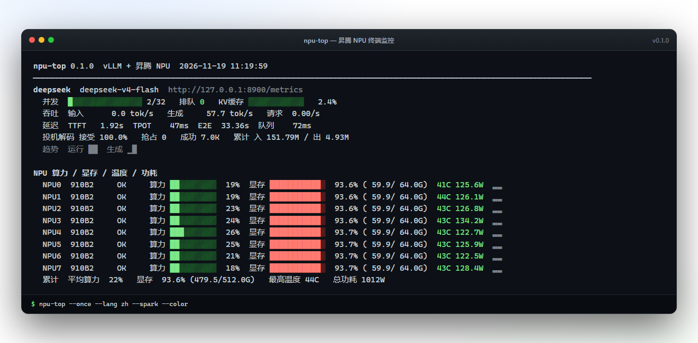
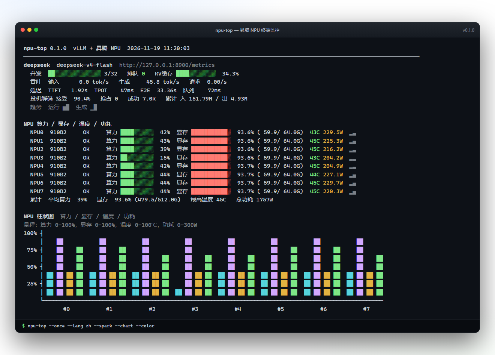
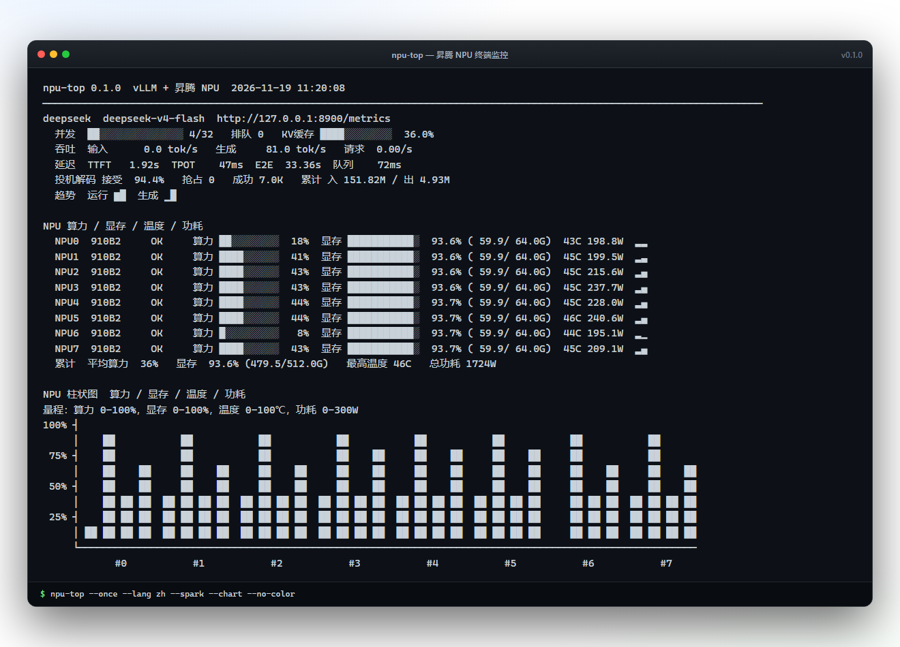

# npu-top

[简体中文](https://github.com/LIRUILONGS/npu-top/blob/main/README.md) | English

[](https://github.com/LIRUILONGS/npu-top/actions/workflows/ci.yml)

Tiny, zero-dependency terminal dashboard for **vLLM** and **Ascend NPU**.

`npu-top` is one Python file and has no third-party runtime packages. It reads two
read-only sources: a vLLM Prometheus endpoint and `npu-smi info`. The result is a
single terminal view that shows both serving quality and NPU health.



*Live sample: DeepSeek V4 Flash on 8 × Ascend 910B2.*

> Status: alpha. The CLI and JSON schema are usable, but may change before 1.0.

## Why another dashboard?

The existing vLLM dashboards are good at serving metrics, but their hardware views
are usually built around NVIDIA (NVML/DCGM). Ascend servers expose a different
interface, so those views are empty or unsupported. This project keeps the useful
parts of those tools and makes Ascend a first-class citizen:

- vLLM throughput, KV cache, queue time, TTFT, TPOT, E2E latency, preemptions and
  speculative-decoding acceptance in one place.
- `npu-smi` AICore, HBM, temperature and power for every card, plus an aggregate row.
- TUI, one-shot text, and JSON output in the same command.
- Zero runtime dependencies; no telemetry and no files written.
- The built wheel is about 17 KB; the source is a single `npu_top.py`.

Related projects that inspired the metric layout:

- [`Gamattention/llm-top`](https://github.com/Gamattention/llm-top): a small vLLM TUI.
- [`InfraWhisperer/llmtop`](https://github.com/InfraWhisperer/llmtop): multi-backend
  monitoring with a single binary.
- [`tomaskir/vllm-monitor`](https://github.com/tomaskir/vllm-monitor): detailed vLLM
  queue, preemption and speculative-decoding metrics.

Those tools are excellent choices on NVIDIA hardware. `npu-top` keeps the same
serving-metric discipline and adds the Ascend hardware view.

## Features

- Live terminal UI with `q` to quit.
- Multiple vLLM endpoints in one screen.
- Per-interval rates (not just cumulative counters): input/output tokens per second,
  requests per second, preemptions in the last interval.
- Optional input/generation throughput bar charts with peak, average, and independent scales.
- Histogram-based TTFT, TPOT, E2E, queue, prefill, decode and ITL averages.
- Optional sparklines and an optional 8-NPU grouped bar chart.
- `--once` for logs, `--json` for scripts and dashboards.
- English/Chinese UI, automatic color detection, `NO_COLOR` support; `--color` forces color for screenshots.
- API keys from environment variables; keys are never printed.

## Install

Requirements: Python 3.9+, Linux for NPU monitoring, and `npu-smi` in `PATH`.

```bash
git clone https://github.com/LIRUILONGS/npu-top.git
cd npu-top
python3 -m pip install --user .
# or
pipx install .
```

You can also run it directly without installing:

```bash
python3 npu_top.py --help
```

## Quick start

```bash
# Default: http://127.0.0.1:8000/metrics + npu-smi info
npu-top

# A DeepSeek endpoint on port 8900, with the vLLM max-num-seqs value
npu-top -e deepseek=http://127.0.0.1:8900 --max-seqs 32 --spark --throughput-chart

# One frame for logs (takes a second sample so rates are meaningful)
npu-top --once

# Instant snapshot without the second sample
npu-top --once --no-warmup

# JSON for automation
npu-top --json

# Optional grouped NPU bar chart
npu-top --chart --spark

# Skip NPU collection on a non-Ascend machine
npu-top --no-npu --once
```

### Common combinations

Options can be freely combined; order does not matter.

```bash
# Chinese UI + sparklines + throughput bars + grouped chart
npu-top --lang zh --spark --throughput-chart --chart

# One frame for logs or screenshots
npu-top --once --lang zh --spark --chart --no-color

# JSON output
npu-top --json --lang zh

# Custom endpoint + concurrency limit + sparklines + throughput bars
npu-top -e deepseek=http://127.0.0.1:8900 --max-seqs 32 --spark --throughput-chart --lang zh
```

`--once` plus `--json` produces JSON (JSON takes precedence). In JSON mode
`--spark` and `--chart` are ignored. Do not pass `--once` or `--json` when you want
the live TUI.

`--throughput-chart` shows the last 30 samples as input/generation throughput
bar charts in the TUI. It needs continuous sampling; `--once` only collects two
samples, so the chart is of limited use. For long-term history, use Prometheus
plus Grafana.

Keys pressed in the TUI: `q` quits; `Ctrl-C` also stops.

`--chart` adds a grouped bar chart for all eight NPUs below the serving metrics:



`--no-color` is useful for logs, screenshots, and email:



Example output (text values are illustrative; the screenshots above are real
samples):

```text
npu-top 0.1.0  vLLM + Ascend NPU  2026-11-19 10:44:25
────────────────────────────────────────────────────────
deepseek  DeepSeek-V4-Flash  http://127.0.0.1:8900/metrics
  Concurrency  ████░░░░░░░░░░░░ 7/32   waiting 0   KV cache █░░░░░░░░░░░   7.2%
  Throughput  prompt      0.0 tok/s   generation    191.7 tok/s   requests  0.00/s
  Latency  TTFT   2.04s  TPOT    39ms  E2E  68.44s  queue     0ms
  Spec decode accept  95.7%   preempt 0   success 6.5K   total in 138.62M / out 4.53M

NPU 算力 / 显存 / 温度 / 功耗
  NPU0  910B2  OK     AICore ███░░░░░░░  32%  HBM ███████████░ 93.6% ( 59.9/ 64.0G)   42C 180.0W
  total  avg AICore  32%   HBM  93.6% (479.3/512.0G)   max temp 42C   total power 1440W
```

## API keys

For endpoints passed on the command line, use `NPU_TOP_API_KEY`:

```bash
export NPU_TOP_API_KEY='...'
npu-top -e deepseek=http://127.0.0.1:8900
```

In the config file, each endpoint can name its own environment variable with
`api_key_env`; this avoids putting secrets in JSON. `--api-key` exists for quick
tests, but it can be visible in the process list, so prefer the environment variable.

## Configuration

`npu-top` auto-loads `~/.config/npu-top/config.json` (or
`$XDG_CONFIG_HOME/npu-top/config.json`) if it exists. Pass `--config PATH` to use a
different file. Command-line options override config values.

```json
{
  "interval": 1.0,
  "timeout": 3.0,
  "max_seqs": 32,
  "endpoints": [
    {
      "name": "deepseek",
      "url": "http://127.0.0.1:8900",
      "api_key_env": "VLLM_API_KEY",
      "max_seqs": 32
    },
    {
      "name": "qwen",
      "url": "http://127.0.0.1:8000/metrics"
    }
  ]
}
```

Notes:

- `url` may be a base URL (`http://host:8000`) or a full metrics URL.
- `--endpoint` replaces the `endpoints` list from the config; it does not append.
- `max_seqs` is only used for the concurrency bar. It does not change vLLM.
- `npu` can be set to `false` to disable hardware collection.
- `npu_smi` can point to a non-standard `npu-smi` binary.

An example is in [`examples/npu-top.json`](https://github.com/LIRUILONGS/npu-top/blob/main/examples/npu-top.json).

## JSON output

```bash
npu-top --json | jq
```

The schema is intentionally flat and stable enough for simple scripts:

```json
{
  "tool": "npu-top",
  "version": "0.1.0",
  "timestamp": "2026-11-19T10:44:25+08:00",
  "services": [
    {
      "name": "deepseek",
      "url": "http://127.0.0.1:8900/metrics",
      "online": true,
      "model": "deepseek-v4-flash",
      "running": 7,
      "waiting": 0,
      "kv_cache_usage": 0.072,
      "generation_tokens_per_second": 191.7,
      "ttft_seconds": 2.04,
      "tpot_seconds": 0.039,
      "spec_decode_accept_percent": 95.7,
      "preemptions": 0
    }
  ],
  "npus": [
    {
      "id": 0,
      "name": "910B2",
      "health": "OK",
      "aicore_percent": 32,
      "hbm_used_mb": 61300,
      "hbm_total_mb": 65536,
      "hbm_percent": 93.5,
      "temperature_c": 42,
      "power_w": 180.0
    }
  ],
  "npu_error": null
}
```

`kv_cache_usage` is a ratio from 0 to 1. Throughput fields are per second; on a
single `--json` run the default warm-up takes two samples. Use `--no-warmup` if you
only need gauges and totals.

## NPU support

`npu-top` parses the tabular output of `npu-smi info`. The parser is written for the
format used by Ascend 910B2 servers and tolerates missing power/temperature fields.
If your `npu-smi` output uses a different table layout, open an issue with the
output (redact serial numbers and hostnames) or send a pull request with a fixture.

The tool does not need root for normal `npu-smi info` collection. If your system
requires elevated privileges, grant read access to the relevant device files rather
than running the dashboard as root.

## Scope

This project is deliberately small. It does **not** include:

- NVIDIA NVML/DCGM collection (use an NVIDIA-native dashboard there).
- Multi-node aggregation or Kubernetes service discovery.
- A built-in Prometheus server, alerting, or long-term storage.
- Write operations against vLLM or NPU devices.

Those are good separate projects. The goal here is one small, dependable view that
works on an Ascend box.

## Development

```bash
python3 -m py_compile npu_top.py
python3 -m unittest discover -s tests -v
```

The test suite covers Prometheus parsing, interval rates, `npu-smi` parsing, config
merging, HTTP fetching and JSON serialization. It uses only the standard library.

See [RELEASING.md](https://github.com/LIRUILONGS/npu-top/blob/main/RELEASING.md) for the PyPI release process.

## License

MIT. See [LICENSE](https://github.com/LIRUILONGS/npu-top/blob/main/LICENSE).
