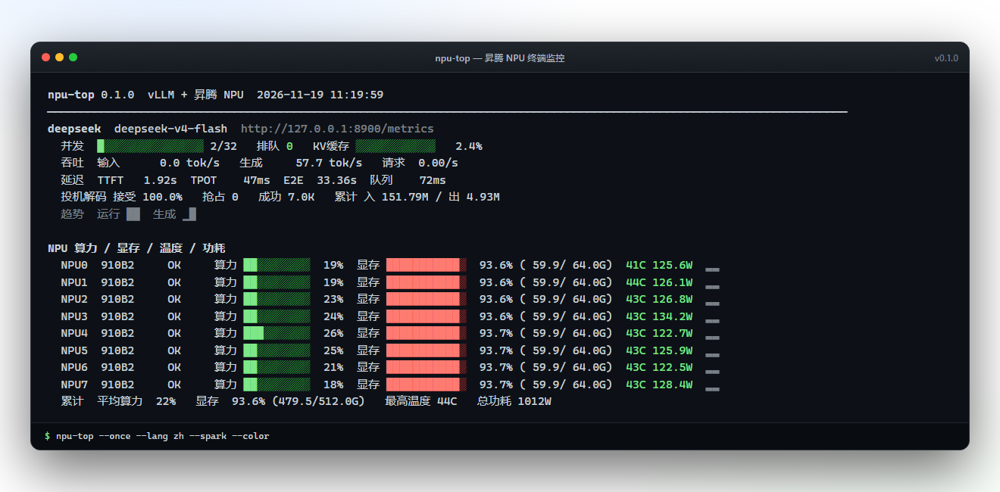
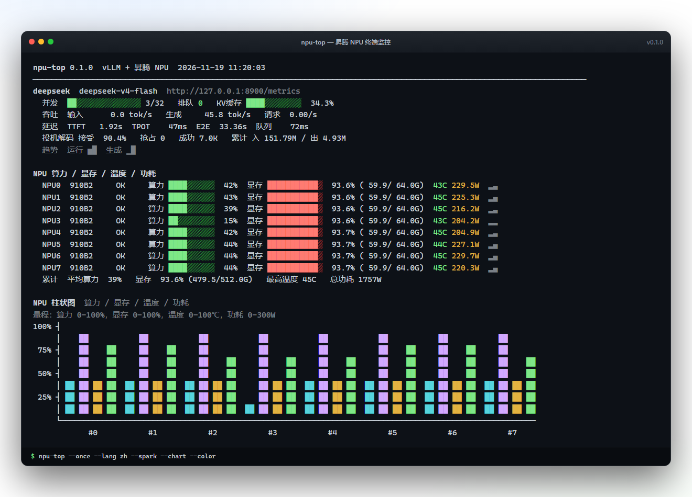
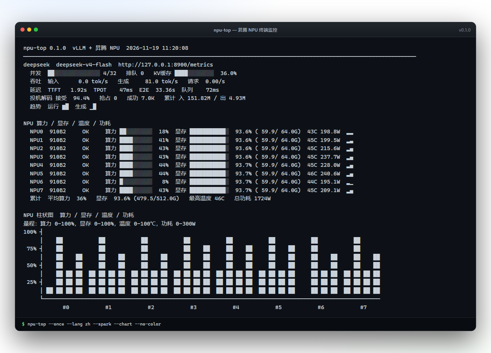

# npu-top

[](https://github.com/LIRUILONGS/npu-top/actions/workflows/ci.yml)

简体中文 | [English](README.en.md)

单文件、零第三方依赖的 **vLLM + 昇腾 NPU** 终端监控工具。

`npu-top` 只有一个 Python 文件，不依赖任何第三方运行时包。它只读地读取两个来源：
vLLM 的 Prometheus 指标接口，以及昇腾的 `npu-smi info`。一个终端界面同时展示
推理服务质量与 NPU 硬件状态。



*实际运行采样：DeepSeek V4 Flash + 8 × 昇腾 910B2。*

> 状态：alpha。CLI 和 JSON 字段已经可用，但 1.0 之前可能调整。

## 为什么还需要一个监控工具

现有的 vLLM 面板很擅长展示服务指标，但硬件视图通常围绕 NVIDIA 的 NVML/DCGM
构建。昇腾服务器使用的是另一套接口，这些面板要么显示为空，要么不支持。`npu-top`
保留这些工具好用的部分，同时把昇腾作为一等公民：

- 一屏看全 vLLM 的吞吐、KV Cache、排队时间、TTFT、TPOT、E2E、抢占和投机解码接受率。
- 通过 `npu-smi` 读取每张卡的 AICore、HBM、温度、功耗，并给出汇总行。
- 同一个命令同时支持实时 TUI、单次文本输出和 JSON 输出。
- 零运行时依赖，不上报遥测，不写状态文件。

相关项目（指标布局参考了它们）：

- [`Gamattention/llm-top`](https://github.com/Gamattention/llm-top)：精简的 vLLM TUI。
- [`InfraWhisperer/llmtop`](https://github.com/InfraWhisperer/llmtop)：多后端、单二进制监控。
- [`tomaskir/vllm-monitor`](https://github.com/tomaskir/vllm-monitor)：完整的 vLLM 排队、抢占和投机解码指标。

这些工具在 NVIDIA 环境中很成熟。`npu-top` 保留同样的服务指标设计，并补上昇腾硬件视图。

## 功能

- 实时终端界面，按 `q` 退出。
- 一个界面同时监控多个 vLLM 端点。
- 区间速率，而不只是累计值：输入/生成 token 每秒、请求每秒、本区间抢占数。
- 可选的输入/生成吞吐柱状图，带峰值、平均值和独立量程。
- 基于 histogram 的 TTFT、TPOT、E2E、排队、prefill、decode 和 ITL 平均延迟。
- 可选趋势曲线，以及可选的 8 卡分组柱状图。
- `--once` 适合日志，`--json` 适合脚本和看板。
- 中英文界面、自动颜色检测、支持 `NO_COLOR`；`--color` 可强制颜色，适合截图。
- API Key 从环境变量读取，不会打印到终端。
- wheel 约 18 KB，源码就是一个 `npu_top.py`。

## 安装

要求：Python 3.9+；采集 NPU 需要 Linux，并且 `npu-smi` 在 `PATH` 中。

```bash
git clone https://github.com/LIRUILONGS/npu-top.git
cd npu-top
python3 -m pip install --user .

# 或者
pipx install .
```

也可以不安装，直接运行：

```bash
python3 npu_top.py --help
```

## 快速开始

```bash
# 默认：http://127.0.0.1:8000/metrics + npu-smi info
npu-top

# 监控 8900 端口的 DeepSeek，并显示 vLLM 的 max-num-seqs
npu-top -e deepseek=http://127.0.0.1:8900 --max-seqs 32 --spark --throughput-chart

# 输出一帧到日志（会采两次样，吞吐和抢占数才有意义）
npu-top --once

# 不采第二次样，立即输出
npu-top --once --no-warmup

# JSON 输出
npu-top --json

# 可选的 NPU 分组柱状图
npu-top --chart --spark

# 非昇腾机器上关闭 NPU 采集
npu-top --no-npu --once
```

### 常用组合

参数可以自由组合，顺序无关。

```bash
# 中文 + 趋势 + 吞吐柱状图 + NPU 柱状图
npu-top --lang zh --spark --throughput-chart --chart

# 输出一帧，适合日志或截图
npu-top --once --lang zh --spark --chart --no-color

# JSON 输出
npu-top --json --lang zh

# 指定端点 + 并发上限 + 趋势 + 吞吐柱状图
npu-top -e deepseek=http://127.0.0.1:8900 --max-seqs 32 --spark --throughput-chart --lang zh
```

`--once` 和 `--json` 同时使用时输出 JSON；JSON 模式下 `--spark` 和 `--chart`
不生效。要进入实时 TUI，不要加 `--once` 或 `--json`。

`--throughput-chart` 在 TUI 中展示最近 30 个采样点的输入/生成吞吐柱状图。
它需要连续采样，`--once` 只有两次采样，图形意义有限；长期历史请使用
Prometheus + Grafana。

TUI 中按 `q` 退出，`Ctrl-C` 也可以停止。

## 示例输出

`--chart` 会在服务指标下方增加 8 卡分组柱状图：



`--no-color` 适合日志、截图和邮件：



以下文本数值仅作示例（截图来自真实采样）：

```text
npu-top 0.1.0  vLLM + 昇腾 NPU  2026-11-19 10:44:25
────────────────────────────────────────────────────────
deepseek  DeepSeek-V4-Flash  http://127.0.0.1:8900/metrics
  并发  ████░░░░░░░░░░░░ 7/32   排队 0   KV缓存 █░░░░░░░░░░░   7.2%
  吞吐  输入      0.0 tok/s   生成    191.7 tok/s   请求  0.00/s
  延迟  TTFT   2.04s  TPOT    39ms  E2E  68.44s  队列     0ms
  投机解码 接受  95.7%   抢占 0   成功 6.5K   累计 入 138.62M / 出 4.53M

NPU 算力 / 显存 / 温度 / 功耗
  NPU0  910B2  OK     算力 ███░░░░░░░  32%  显存 ███████████░ 93.6% ( 59.9/ 64.0G)  42C 180.0W
  累计  平均算力  32%   显存  93.6% (479.3/512.0G)   最高温度 42C   总功耗 1440W
```

## API Key

命令行传入的端点使用 `NPU_TOP_API_KEY`：

```bash
export NPU_TOP_API_KEY='...'
npu-top -e deepseek=http://127.0.0.1:8900
```

配置文件中的每个端点可以用 `api_key_env` 指定自己的环境变量，避免把密钥写进 JSON。
`--api-key` 只用于临时测试，但它可能出现在进程列表中，建议优先使用环境变量。

## 配置文件

如果存在 `~/.config/npu-top/config.json`（或
`$XDG_CONFIG_HOME/npu-top/config.json`），`npu-top` 会自动读取。也可以用
`--config PATH` 指定其他文件。命令行参数优先于配置。

```json
{
  "interval": 1.0,
  "timeout": 3.0,
  "max_seqs": 32,
  "endpoints": [
    {
      "name": "deepseek",
      "url": "http://127.0.0.1:8900",
      "api_key_env": "VLLM_API_KEY",
      "max_seqs": 32
    },
    {
      "name": "qwen",
      "url": "http://127.0.0.1:8000/metrics"
    }
  ]
}
```

说明：

- `url` 可以是基础地址（`http://host:8000`），也可以是完整的 metrics 地址。
- `--endpoint` 会替换配置中的 `endpoints` 列表，不会追加。
- `max_seqs` 只用于并发进度条，不会修改 vLLM。
- `npu` 设为 `false` 可以关闭硬件采集。
- `npu_smi` 可以指向非标准路径的 `npu-smi`。

示例文件见 [`examples/npu-top.json`](examples/npu-top.json)。

## JSON 输出

```bash
npu-top --json | jq
```

字段保持扁平，方便脚本直接消费：

```json
{
  "tool": "npu-top",
  "version": "0.1.0",
  "timestamp": "2026-11-19T10:44:25+08:00",
  "services": [
    {
      "name": "deepseek",
      "url": "http://127.0.0.1:8900/metrics",
      "online": true,
      "model": "deepseek-v4-flash",
      "running": 7,
      "waiting": 0,
      "kv_cache_usage": 0.072,
      "generation_tokens_per_second": 191.7,
      "ttft_seconds": 2.04,
      "tpot_seconds": 0.039,
      "spec_decode_accept_percent": 95.7,
      "preemptions": 0
    }
  ],
  "npus": [
    {
      "id": 0,
      "name": "910B2",
      "health": "OK",
      "aicore_percent": 32,
      "hbm_used_mb": 61300,
      "hbm_total_mb": 65536,
      "hbm_percent": 93.5,
      "temperature_c": 42,
      "power_w": 180.0
    }
  ],
  "npu_error": null
}
```

`kv_cache_usage` 是 0 到 1 的比例。吞吐字段是每秒值；单次 `--json` 默认会采两次样，
只需要瞬时 gauges 和累计值时可以加 `--no-warmup`。

## 昇腾 NPU 支持

`npu-top` 解析 `npu-smi info` 的表格输出，目前按昇腾 910B2 服务器的格式编写，
并兼容功耗/温度缺失的情况。如果你的 `npu-smi` 输出格式不同，欢迎带脱敏后的
fixture 提 issue 或 PR。

正常情况下读取 `npu-smi info` 不需要 root。如果系统要求提权，建议只给相关设备
文件增加读权限，不要用 root 长期运行监控面板。

## 范围

这个项目刻意保持很小，不包含：

- NVIDIA NVML/DCGM 采集（NVIDIA 环境请使用对应的原生面板）。
- 多节点聚合或 Kubernetes 服务发现。
- 内置 Prometheus 服务、告警或长期存储。
- 对 vLLM 或 NPU 设备的写操作。

这些适合做成独立项目。这里的目标是：在昇腾机器上提供一个足够小、足够可靠的统一视图。

## 开发

```bash
python3 -m py_compile npu_top.py
python3 -m unittest discover -s tests -v
```

测试覆盖 Prometheus 解析、区间速率、`npu-smi` 解析、配置合并、HTTP 拉取和 JSON
序列化，全部使用标准库。

## 许可证

MIT，见 [LICENSE](LICENSE)。
